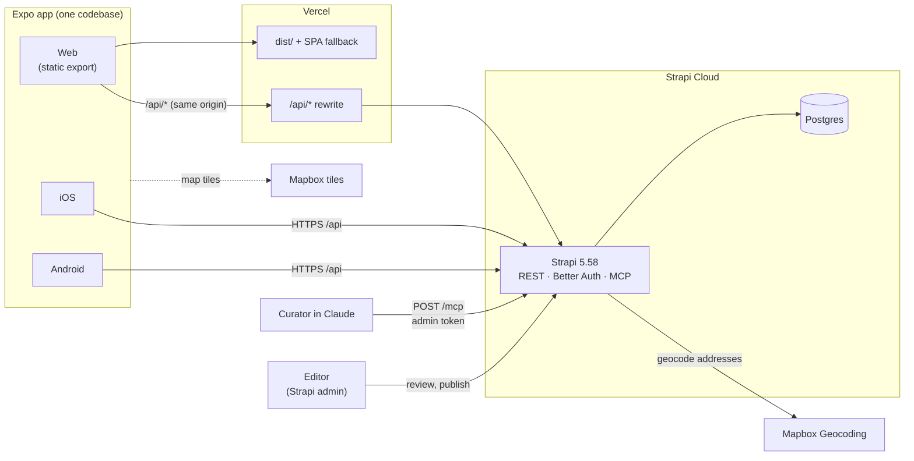
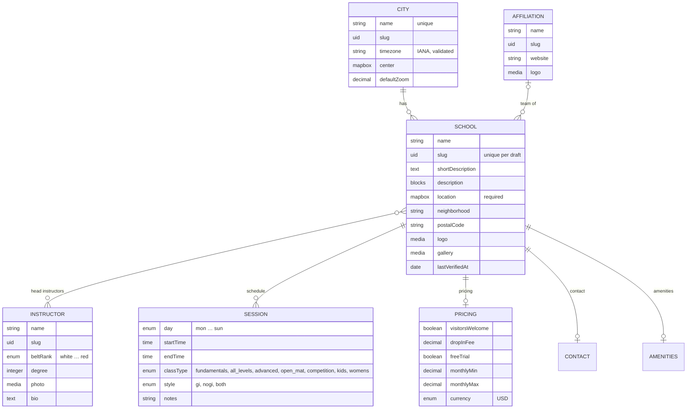
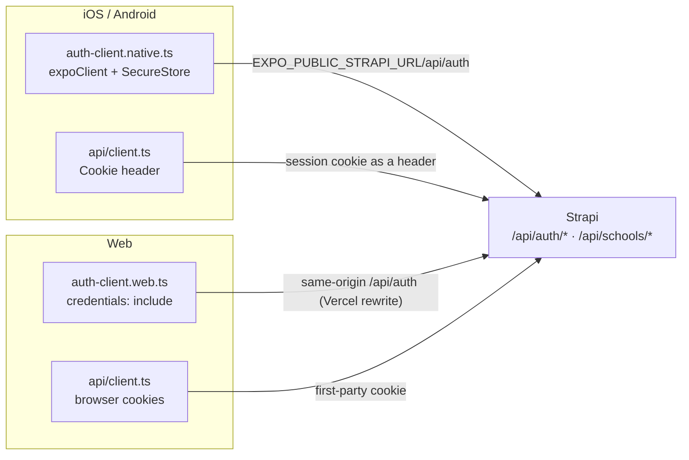
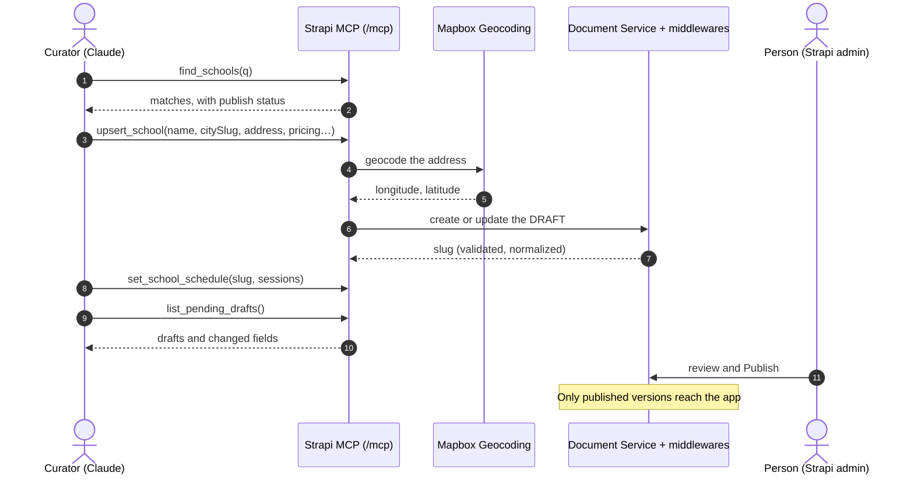
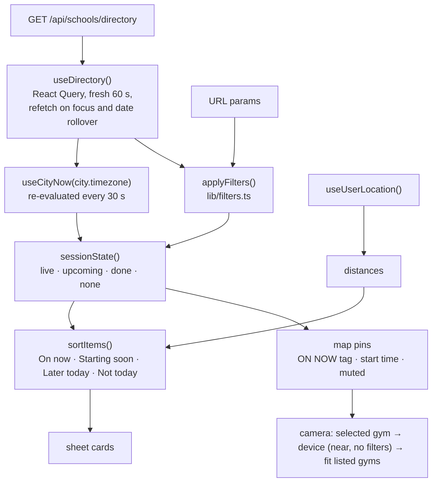
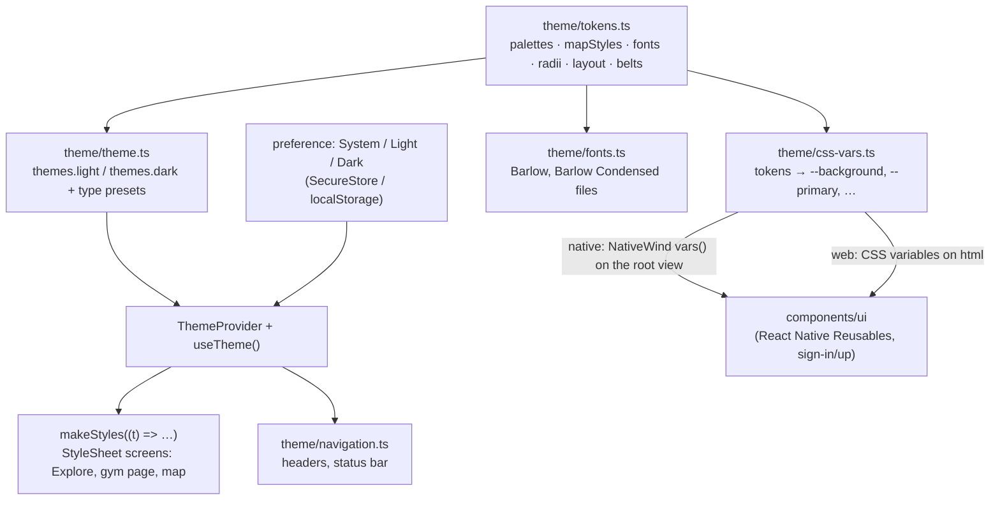
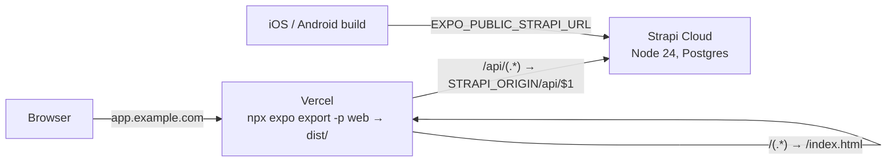
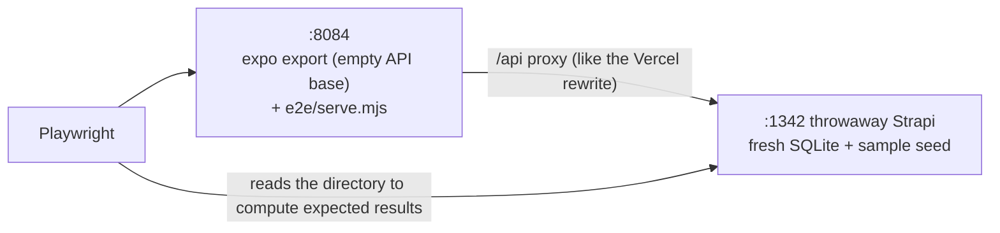

# MatFinder architecture

How the pieces fit together: the Strapi backend, the Expo app (iOS, Android and web), the MCP curation tools, auth, maps, theming, deployment and tests. For *why* things are built this way, see the plan in [`docs/plan/`](plan/) (the build spec, [`06-build-spec.md`](plan/06-build-spec.md), is the source of truth). For working rules, see [`CLAUDE.md`](../CLAUDE.md).

Diagrams are Mermaid; GitHub renders them.

## Contents

1. [System at a glance](#1-system-at-a-glance)
2. [Repository map](#2-repository-map)
3. [Content model](#3-content-model)
4. [API surface and the gate](#4-api-surface-and-the-gate)
5. [Document rules and bootstrap](#5-document-rules-and-bootstrap)
6. [Accounts and auth](#6-accounts-and-auth)
7. [Curating listings with Claude (MCP)](#7-curating-listings-with-claude-mcp)
8. [The app: screens and data flow](#8-the-app-screens-and-data-flow)
9. [Time rules](#9-time-rules)
10. [Maps](#10-maps)
11. [Theming](#11-theming)
12. [Deployment](#12-deployment)
13. [Testing](#13-testing)
14. [Local development](#14-local-development)
15. [Constraints](#15-constraints)

---

## 1. System at a glance

MatFinder is a map-first directory of Brazilian Jiu-Jitsu gyms, Las Vegas first. Anyone can browse the map and filter by *training today*, *visitors welcome* and *Gi / No-Gi*; a free account opens each gym's full page. Listings are curated by a person working with Claude through Strapi's MCP server: Claude only writes drafts, and a person publishes them in the Strapi admin.



| Piece | Tech | Where |
|---|---|---|
| Backend | Strapi 5.58.0, TypeScript | `server/`, deployed to Strapi Cloud (Postgres); SQLite locally |
| End-user auth | Better Auth via `@strapi-community/plugin-better-auth` (beta), roles via `plugin-api-permissions` (alpha) | `server/src/lib/auth.ts` |
| Curation | Strapi's built-in MCP server + 10 custom tools and a prompt, an admin page and a homepage widget | `server/src/plugins/matfinder/` (a local plugin) |
| App | Expo SDK 57, expo-router, React Native 0.86, NativeWind 4, React Query 5 | `mobile/`, web deployed to Vercel |
| Maps | `@rnmapbox/maps` (native), `react-map-gl` + `mapbox-gl` 3 (web), `strapi-plugin-map-box` (admin field) | `mobile/components/LocationMap*.tsx` |

## 2. Repository map

```
matt-finder/
├── docs/plan/            Product → users → requirements → tech → build spec (01–06), issue drafts
├── server/               Strapi 5
│   ├── config/           server (port 1339, MCP on), plugins, middlewares (CORS from WEB_ORIGINS)
│   ├── scripts/          test-server.sh: throwaway seeded Strapi on :1342
│   ├── src/api/          city, school, instructor, affiliation (+ custom school routes)
│   ├── src/components/   schedule.session, school.pricing / contact / amenities
│   ├── src/document-middlewares/   rules that run on every write (slug, validation, normalizing, user role)
│   ├── src/lib/          auth, directory (public shape), drafts, geocode, permissions, time, upsert
│   ├── src/plugins/matfinder/   the MatFinder plugin: MCP tools, admin page (Gyms), Gym directory widget, admin API
│   ├── src/seed/         fictional Las Vegas sample data (SEED_SAMPLE_DATA=true, dev only)
│   └── tests/            unit (Vitest) and integration (against the throwaway Strapi)
└── mobile/               Expo app
    ├── app/              routes: index (Explore), schools/[slug], account, sign-in, sign-up
    ├── components/       LocationMap(.web), explore/*, school/*, kit/* (Mat room pieces), map/MapPin, ui/* (RNR)
    ├── hooks/            useDirectory, useCityNow, useSchool, useSession, useUserLocation
    ├── lib/              api client, filters, time, explore, week, geo, auth clients
    ├── theme/            tokens.ts (edit this), theme, css-vars, fonts, ThemeProvider, navigation
    ├── e2e/              Playwright spec, global setup, a tiny static server with an /api proxy
    └── vercel.ts         build command, /api rewrite, SPA fallback
```

## 3. Content model



- **Draft and publish** is on for school, instructor and affiliation (drafts come from MCP and the admin; the public API reads published only). City has none.
- `SESSION`, `PRICING`, `CONTACT` and `AMENITIES` are components: they live inside the school, not as their own collections. Contact holds phone, email, website and Instagram; amenities are seven booleans (showers, changing rooms, parking, gi rental, pro shop, kids area, air conditioning).
- `location` and `center` are the `global::map-box` custom field (longitude, latitude, address, zoom, pitch, bearing).
- Better Auth's tables (`ba_user`, session, account, verification, jwks) come from the plugin, extended in `server/src/extensions/better-auth/`.

## 4. API surface and the gate

| Endpoint | Who | Returns |
|---|---|---|
| `GET /api/schools/directory?city=las-vegas` | Everyone (Public role) | The city (name, time zone, center, zoom), its local date and weekday, and each published school with coordinates in a **trimmed** shape: name, logo, area, team, styles, programs, visitors welcome, drop-in fee, and **today's sessions only**. `Cache-Control: public, max-age=60`. |
| `GET /api/schools/slug/:slug` | Signed-in users (Authenticated role) | The full published page: description, gallery, coaches, pricing, contact, amenities, the whole week, `nextSessionToday`, `lastVerifiedAt`. |
| `GET /api/cities` | Everyone | Core find. |
| `/api/auth/*` | Everyone | Better Auth: sign up, sign in, session, sign out. |
| `POST /mcp` | Admin tokens holding the MatFinder MCP actions | The 10 curation tools and the `find_new_gyms` prompt. |
| `POST /api/matfinder/claims` | Signed-in users (Authenticated role) | `{ schoolSlug, role, phone, message? }`: claim a published gym. `409 ALREADY_CLAIMED` / `CLAIM_OPEN`, `429 TOO_MANY_CLAIMS`, `422` for a bad phone. |
| `GET /api/matfinder/claims/mine?school=` | Signed-in users | The user's latest claim status on that gym. |
| `/matfinder/*` (admin API) | Admins with `plugin::matfinder.read` (and `claims.review` to act) | Gyms, totals, From the web, the claims board and its actions. |

The gate is enforced on the server, not in the app: `plugin-api-permissions` grants are seeded in `bootstrap()` (`server/src/lib/permissions.ts`) and nothing else is granted (no core CRUD on schools, instructors or affiliations, nothing on users). The public directory is built field by field (`toDirectoryItem` in `server/src/lib/directory.ts`): the full schedule is read to work out today's sessions, styles and programs, but only today's sessions leave the server.

`01-custom-school.ts` is named so it loads before the core router; otherwise `/schools/directory` would match `GET /schools/:id`.

## 5. Document rules and bootstrap

Document Service middlewares (registered in `register()`) run for every write: admin, REST, MCP and the seed alike.

| Middleware | What it does |
|---|---|
| `slug` | Fills `slug` from the name on API and seed creates (the admin fills `uid` fields itself). |
| `normalize-contact` | `@handle` and Instagram URLs become `handle`; websites get `https://`. |
| `schedule-validate` | Valid day, class type and style; real times; each session ends after it starts; at most 100 sessions. |
| `pricing-validate` | Fees are 0 or more; the monthly maximum isn't below the minimum. |
| `city-validate` | `timezone` must be an IANA zone the runtime knows. |
| `user-role` | New Better Auth users get the Authenticated role (the plugin assigns none, and a user without roles is treated as Public). |

`bootstrap()` then:

1. Creates **real unique indexes** with raw SQL: `unique: true` is validation-only and Document Service writes bypass it. Slugs are unique among draft rows (one per document); `ba_user.email` closes a sign-up race.
2. Seeds the api-permissions grants and gives the Authenticated role to any user without one.
3. Loads the fictional sample data when `SEED_SAMPLE_DATA=true` (development only).

## 6. Accounts and auth

Better Auth runs inside Strapi (`server/src/lib/auth.ts`): email and password, 30-day sliding sessions, serial ids (required by the Strapi adapter), plus the `expo()`, `jwt()` and `dash()` plugins (`jwt` and `dash` power the admin's Better Auth dashboard).



- **Native** keeps the session cookie in SecureStore and sends it as an explicit `Cookie` header (`setCookieProvider`).
- **Web** calls `/api` on its own origin: in production Vercel rewrites it to Strapi, so the session cookie is first-party (Safari and third-party-cookie blocking would drop a `*.vercel.app` → `*.strapiapp.com` cookie). Better Auth rejects a relative `baseURL`, so the web client prepends `window.location.origin`.
- The app reads the session once (`AuthProvider` in `hooks/useSession.tsx`). The gym page redirects to `/sign-in?redirect=/schools/<slug>` when signed out or when the server answers 401/403; `safeRedirect` only allows in-app paths.

## 7. Curating listings with Claude (MCP)

Strapi's MCP server is on (`config/server.ts`, `MCP_ENABLED`). The tools live in the MatFinder plugin: `server/src/plugins/matfinder/server/src/mcp/index.ts` registers one **admin action per tool** in `register()` (`plugin::matfinder.mcp.<tool>`, under Plugins → MatFinder), so a curator's admin token can be granted exactly these tools and none of the generic content-manager ones. The plugin also adds the admin's **MatFinder** page (every gym and its publish status) and a **Gym directory** homepage widget; both need the `plugin::matfinder.read` permission.

| Tool | Does |
|---|---|
| `list_reference_data` | The cities, teams and instructors that already exist (names and slugs), so Claude reuses them instead of creating duplicates. |
| `find_schools` | Search drafts with publish status; filter for stale listings (`staleDays`). Paged. |
| `get_school_draft` | One listing's draft, schedule as `HH:mm`, description as plain text. (Not `get_school`: the content manager already registers that name.) |
| `upsert_school` | Create or partially update a school **draft**. Geocodes the street address with Mapbox before the write. |
| `set_school_schedule` | Replace the weekly schedule of a draft. |
| `upsert_instructor`, `upsert_affiliation` | Drafts of coaches and teams. |
| `list_pending_drafts` | What's waiting for review, with the fields that changed. |
| `find_possible_duplicates` | Is a gym found on the web already listed? Matches a similar name in the city, the same phone, website or Instagram, or being within 150 m. |
| `add_gym_from_web` | Add a gym found on the web as a **draft** with its source pages (`sourceUrls`). Refuses a likely duplicate (`DUPLICATE_SUSPECTED`, with the candidates) unless the agent confirms it's a different gym. |

The **`find_new_gyms`** prompt (`{ city, area? }`) gives an agent with web search the whole loop: search, check duplicates, add drafts with sources, add schedules, report. Gyms it adds carry three private fields on the school (`origin: web-agent`, `sourceUrls`, `discoveredAt`), visible in the admin and never in public responses; the admin's **From the web** tab lists them until they're published.



No tool publishes, unpublishes, deletes or uploads media. Results stay under the MCP client's ~1 MB limit (`guard()` returns `RESULT_TOO_LARGE` with a hint), and validation failures come back as structured `VALIDATION_ERROR`s with the field path.

### Gym claims (the MatFinder plugin)

A gym owner (or manager, head instructor, staff) taps **Claim it** on the gym page (`/schools/[slug]/claim`, account only) and sends their role, a phone number and an optional note. The claim waits on the admin's **MatFinder → Claims** tab, where someone with `plugin::matfinder.claims.review` calls them, marks it *contacted*, then **accepts** or **rejects** it (a rejection, or later removing the owner, needs a note). An accepted claim makes the gym `claimed: true` in the directory and on the gym page ("Claimed by the owner"); who claimed it, their phone and notes never leave the admin.

Rules (`server/src/plugins/matfinder/server/src/services/claims.ts`, states in `domain/claims.ts`): one open claim per user per gym, at most 5 open per user, one accepted claim per gym (accepting closes that gym's other open claims), and a claimed gym can't be claimed again until the owner is removed. Claims store the gym's documentId, slug and name rather than a relation, so a gym's draft and published versions both match. The **Claims to review** homepage widget shows the counts and the newest claims.

## 8. The app: screens and data flow

| Route | Screen | Data |
|---|---|---|
| `/` | Explore: full-screen map and a bottom sheet (a left panel at ≥ 768 px wide) with search, filters, sort and gym cards; tapping a pin or card turns the sheet into that gym's preview | `useDirectory()` (public) |
| `/schools/[slug]` | The full gym page (account only) | `useSchool(slug)` |
| `/account` | Sign in/out, and System / Light / Dark | `useSession()` |
| `/sign-in`, `/sign-up` | React Native Reusables forms on Better Auth, with `?redirect=` | `authClient` |

Filters, sort and the selected gym live in the URL (`?q=&today=1&visitors=1&style=gi&sort=distance&school=<slug>`), so links and the back button work.



The pure logic is in `lib/` and unit-tested: `filters.ts`, `time.ts`, `explore.ts` (session states, groups, pin tones, formatting) and `week.ts` (next class this week, the week grid, rest of the week, the "Can I train here tonight?" checklist and the Add to calendar link).

## 9. Time rules

"Now" is always the **city's** local time, never the device's: someone in Tokyo planning a Las Vegas trip sees Las Vegas's "On now" and "Training today".

- The server computes `todaySessions` for the city's local date and sends `localDate` and `weekday` with the directory.
- The app derives the city-local date, weekday and minutes with `Intl.DateTimeFormat` and the city's time zone (`cityNow()` in `lib/time.ts`), refreshes it every 30 seconds, and refetches the directory when the city's date rolls over.
- Add to calendar uses Google Calendar's `ctz` parameter with the city's time zone, so the event lands at the right time wherever the phone is.

## 10. Maps

`components/LocationMap.tsx` is metravel-explore's `@rnmapbox/maps` component; `LocationMap.web.tsx` has the same props and ref API on `react-map-gl` (Metro picks the `.web.tsx` file on the web). MatFinder adds:

- **Pins** (`components/map/MapPin.tsx`, shared): a green ON NOW tag, a start-time tag, or a small muted pin when a gym has nothing left today; the selected pin is larger with a halo and the others fade. `pinGeometry()` anchors the pin's center, not the tag, on the coordinates.
- **A declarative camera**: Explore passes `camera` (fit bounds, or center and zoom) with a `key`, plus `cameraPadding` for the sheet and map buttons. The map moves only when the key changes, so a 30-second refresh never snaps it back after the user panned.
- **Map style from the theme**: `mapStyles` in `theme/tokens.ts` (Mapbox `light-v11` / `dark-v11`).
- Without `EXPO_PUBLIC_MAPBOX_ACCESS_TOKEN` (a public `pk.` token), Explore shows the list full height. `mobile/package.json` overrides `@rnmapbox/maps`'s optional `mapbox-gl ^2` peer so the web gets mapbox-gl 3.

## 11. Theming

The "Mat room" look (Direction B), light ("paper") and dark ("ink"), comes from **one file: `mobile/theme/tokens.ts`**. To change how the app looks, edit it; don't hard-code colors in components and don't use `dark:` classes.



- `makeStyles` builds both modes' StyleSheets once, up front; `useStyles()` returns the current one.
- `tailwind.config.js` maps the RNR color names to `rgb(var(--x) / <alpha-value>)` and repeats the font names; `global.css` holds the light defaults. `theme/tokens.test.ts` fails if either drifts from the tokens, and checks WCAG AA (4.5:1) for every text token on the surfaces it's used on, in both modes.
- Light/dark follows the system (`app.json` `userInterfaceStyle: "automatic"`) unless the user picks one on Account.
- Fonts load behind the splash screen (`useFonts(fontFiles)` in `app/_layout.tsx`). Custom fonts carry their weight in the family name, so styles use `fonts.*` / `type.*`, not `fontWeight`.

**To change the look:** edit a value in `palettes` (both modes), run `npm run test:unit` (contrast and drift checks), and if you changed a light value that the RNR components use, update the matching triplet in `global.css` (the test names it). To change the map, paste a Mapbox Studio style URL into `mapStyles`. To change typeface, install its `@expo-google-fonts` package, import the weights in `theme/fonts.ts`, rename them in `fonts` and in `tailwind.config.js`.

## 12. Deployment



- **Web (Vercel):** root directory `mobile`, config in `mobile/vercel.ts` (`@vercel/config`): build `npx expo export -p web`, output `dist`, then the `/api` rewrite and the SPA fallback, in that order. `STRAPI_ORIGIN` is a Vercel-only env var; `EXPO_PUBLIC_WEB_API_BASE` is empty in production.
- **Backend (Strapi Cloud):** Node 24, Postgres injected by Strapi Cloud. Set `BETTER_AUTH_URL` (bare origin), `BETTER_AUTH_SECRET`, `BETTER_AUTH_DASHBOARD_SECRET`, `WEB_ORIGINS` (CORS and trusted origins), `MAPBOX_ACCESS_TOKEN` (admin map field) and `MAPBOX_GEOCODING_TOKEN` (server-only). Never set `SEED_SAMPLE_DATA` there.
- **Native builds** need `EXPO_PUBLIC_STRAPI_URL` and `EXPO_PUBLIC_MAPBOX_ACCESS_TOKEN`, and a rebuild whenever `app.json` changes. `RNMAPBOX_MAPS_DOWNLOAD_TOKEN` is optional: @rnmapbox/maps 10.3 no longer needs a secret download token.
- The remaining deploy steps (Strapi Cloud project, Vercel project, production smoke test, real listings) are listed in M9's PR (#26).

## 13. Testing

| Suite | Command | What it covers |
|---|---|---|
| Server unit | `cd server && npm run test:unit` | slugify, schedule rules, the directory shape |
| Server integration | `cd server && npm run test:integration:isolated` | The real API and MCP against a throwaway seeded Strapi on **:1342** (`strapi start`, so MCP lists exactly 8 tools) |
| App unit | `cd mobile && npm run test:unit` | `lib/` (filters, time, explore, week) and `theme/` (contrast, drift) |
| App e2e | `cd mobile && npm run test:e2e` | Playwright: filters → card → preview → View gym → sign up → gym page → reload → sign out |
| Types | `cd mobile && npm run typecheck` | The app, plus `e2e/` and `vercel.ts` |



Stop `npm run develop` before the integration or e2e suites: the throwaway server builds into the same `server/dist`. Playwright needs Chromium (`npx playwright install chromium`, or point `PLAYWRIGHT_CHROMIUM_PATH` at an installed one).

## 14. Local development

| Port | What |
|---|---|
| 1339 | Strapi (`cd server && npm run develop`); admin at `http://matfinder.localhost:1339/admin` |
| 8083 | Expo (`cd mobile && npm run web`, or `npm start` for native) |
| 1342 | Throwaway Strapi for the integration and e2e suites |
| 8084 | The exported web build in e2e |

Other projects on this machine use 1337, 1338, 1340, 1341, 8081, 8082 and 3000, so MatFinder doesn't. Open the admin on `matfinder.localhost`: every Strapi admin uses the same cookie names, and on `localhost` another project's login would overwrite MatFinder's.

Local data is SQLite (`server/.tmp/data.db`); `SEED_SAMPLE_DATA=true` loads eight fictional "Sample … (Demo)" gyms in Las Vegas.

### iPhone Simulator (needs a Mac)

The iOS Simulator only runs on macOS with Xcode. Expo Go won't work: `@rnmapbox/maps` is native code, so the app needs its own build (`expo run:ios`). The iOS Mapbox SDK no longer needs a secret download token; only the public `pk.` token.

1. **Xcode:** install it from the App Store and open it once. In Xcode → Settings → Components, get the iOS Simulator; in Settings → Locations, pick the latest Command Line Tools.
2. **CocoaPods and Node 24:** `brew install cocoapods`, and Node 24 (for example `nvm install 24`). Watchman isn't needed on SDK 56 and later.
3. **Reach Strapi:** Strapi listens on all interfaces, so the Simulator can use the dev machine's LAN address. Check it from the Mac first: open `http://<dev-machine-LAN-IP>:1339/api/schools/directory?city=las-vegas` in Safari; it should show JSON. If it doesn't, run Strapi on the Mac instead.
4. **Clone and install:** `git clone https://github.com/PaulBratslavsky/matfinder.git`, then `cd matfinder/mobile && npm ci`.
5. **`mobile/.env`:** `EXPO_PUBLIC_STRAPI_URL` and `EXPO_PUBLIC_WEB_API_BASE` set to `http://<dev-machine-LAN-IP>:1339`, `EXPO_PUBLIC_DEFAULT_CITY=las-vegas`, and `EXPO_PUBLIC_MAPBOX_ACCESS_TOKEN` set to the public `pk.` token.
6. **Build and run:** `npm run ios`. The first build takes several minutes; it boots the Simulator, installs MatFinder and starts Metro on 8083. Rebuild with `npm run ios` after a native change (a new native package or an `app.json` edit); JavaScript changes reload on their own.

In the Simulator: Features → Location → Custom Location (36.1699, -115.1398) puts you in Las Vegas, so the map centers on you; without it the map fits every gym. ⌘⇧A switches light and dark.

## 15. Constraints

From the user (requirements, not preferences; see `CLAUDE.md`):

- Never commit to `main`; branch → PR → merge (a repo hook blocks direct commits).
- No Docker, and no local Postgres: SQLite locally, Postgres only on Strapi Cloud.
- npm only, with Node 24 / npm 11 lockfiles.
- Commands, versions and conventions in the spec and issues are user decisions: ask before substituting any of them.
- Secrets stay out of chat, issues and commits.
