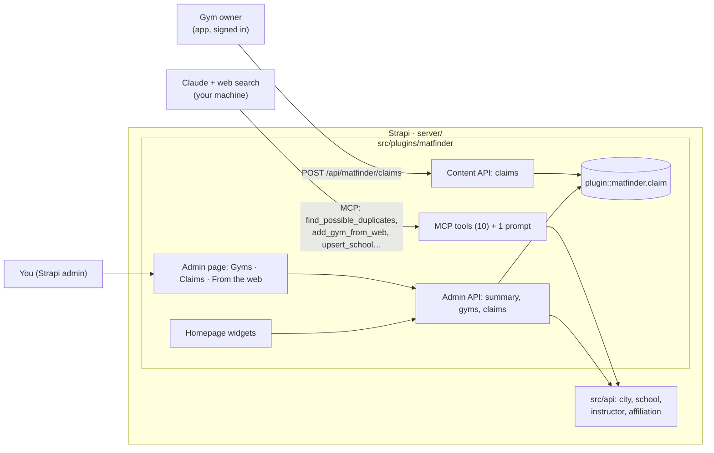
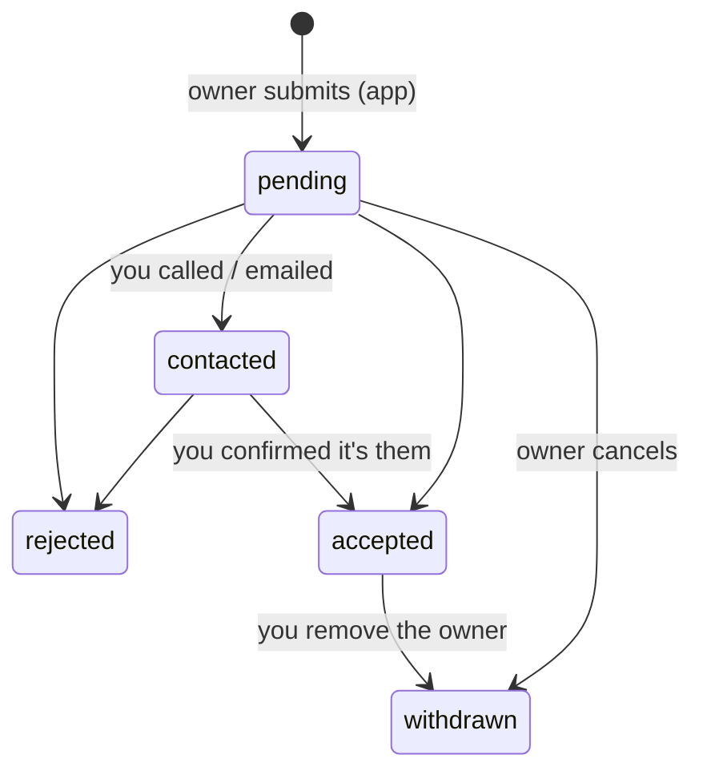

# 07 · The MatFinder plugin: gyms from the web, an admin area and claims

**Status:** plan, for review (2026-10-14). Builds on the merged POC (M0–M9). Milestones **M10–M12** below.

Modeled on the `maison` plugin (`PaulBratslavsky/maison-tanstack`, `strapi/src/plugins/maison`): its MCP tool pattern, per-tool admin permissions, homepage widgets, tabbed admin page and request → review → accept boards. Its LINE messaging, OAuth customer sessions, boutique/product domain, demo seed and in-admin chat drawer are not copied.

## What the user decided (2026-10-14)

| Question | Decision |
|---|---|
| Where does the agent that finds gyms on the web run? | **Outside Strapi.** You ask Claude (Code or Desktop, with its own web search) to find gyms; it calls the plugin's MCP tools to check for duplicates and add drafts with their source links. No AI keys or scraping code on the server. |
| How does a gym owner claim a gym? | **In the app, signed in.** A "Claim this gym" link on the gym page opens a short form (role, phone, note). |
| What does an accepted claim give the owner? | **A "Claimed" badge** on the gym, with the owner's account linked to it. Owner editing comes later. |
| What does the homepage widget show? | **Claims waiting for review, new gyms from the agent, and directory totals.** |
| How are claims confirmed? | **By hand.** You see the request in the admin, contact the owner, then accept or reject it. |

## Architecture



- **The plugin owns the curation layer:** the MCP tools, claims, the admin page, the widgets and their APIs.
- **The app keeps the content model** (`api::school.school` and the rest), the public directory and the gym page API.
- **The plugin reads and writes schools through the school service and the Document Service,** so every existing write rule still applies.

## Plugin layout

Same shape as maison, trimmed:

```
server/src/plugins/matfinder/
├── package.json            strapi.kind = plugin, name = matfinder; exports ./strapi-admin and ./strapi-server
├── admin/src/
│   ├── index.ts            menu link, page, 2 homepage widgets, permissions
│   ├── pages/MatFinderPage.tsx   tabs: Gyms · Claims · From the web (tab in ?tab=)
│   ├── components/         GymsTable, ClaimsBoard, ClaimDialog, FromWebList, ClaimsWidget, DirectoryWidget
│   └── permissions.ts, poll.ts, singleFlight.ts, tabs.ts
└── server/src/
    ├── index.ts, register.ts (MCP + document rules), bootstrap.ts (RBAC actions)
    ├── content-types/claim/schema.json
    ├── mcp/                define.ts, schemas.ts, tools/* (moved from server/src/mcp), prompts/find-new-gyms.ts
    ├── services/           gyms (list, summary, duplicates), claims (state machine), discovery
    ├── controllers/, routes/index.ts   admin + content-api routes
    └── domain/             service-result, tool-result, http-result, duplicate scoring (pure, unit-tested)
```

- **Build:** `@strapi/sdk-plugin` (`strapi-plugin build`) → `dist/`.
  - The host loads it from `config/plugins.ts`: `matfinder: { enabled: true, resolve: './src/plugins/matfinder' }`.
  - `server/package.json` builds the plugin before Strapi: `build`, `develop` and `postinstall` (Strapi Cloud runs `npm install` + `npm run build`).
- **Dependencies, to verify in M10:** the plugin should resolve `@strapi/*` from `server/node_modules` and have no `node_modules` of its own. That avoids maison's duplicate `@strapi/utils` problem, where `ValidationError`s from a second copy become 500s. If `strapi-plugin build` insists on its own install, copy maison's `share-strapi-utils` step instead.

## Data model

**New: `plugin::matfinder.claim`** (`matfinder_claims`, no draft/publish, hidden from the Content Manager; managed on the plugin page):

| Field | Type | Notes |
|---|---|---|
| `school` | relation manyToOne → `api::school.school` | required |
| `user` | relation manyToOne → `plugin::better-auth.user` | who asked; private |
| `name`, `email` | string, email | copied from the account when the claim is made |
| `phone` | string | required, for the call |
| `role` | enum `owner, manager, head_instructor, staff` | |
| `message` | text ≤ 1000 | optional note from the owner |
| `status` | enum `pending, contacted, accepted, rejected, withdrawn` | default `pending` |
| `adminNote` | text | yours; never public |
| `handledBy` | string | admin's name on the last change |
| `contactedAt`, `decidedAt` | datetime | |



**Rules on claims:**
- **One open claim per user per gym.** Open means pending or contacted.
- **At most 5 open claims per user.**
- **One accepted claim per gym.** Accepting closes that gym's other open claims as `rejected`, with the note "Another claim was accepted".
- **A claimed gym can't be claimed again** until you remove the owner, which sets the accepted claim to `withdrawn`.

**School: three new private fields** (in the app's content type; admin only, never in the public API):
- `origin`: enum `manual, web-agent`, default `manual`.
- `sourceUrls`: json, the pages the agent used.
- `discoveredAt`: datetime.

**Public `claimed` flag.** The directory and gym page gain `claimed: boolean`. It's worked out from accepted claims, not stored on the school, so accepting a claim doesn't create a new school draft or need a re-publish. The owner's identity is never public.

## Endpoints

**Content API** (the app; Better Auth session; grants seeded for the Authenticated role):

| Route | Does |
|---|---|
| `POST /api/matfinder/claims` | `{ schoolSlug, role, phone, message? }`: a pending claim for the signed-in user. Fails with `404` (no published gym), `409 ALREADY_CLAIMED` or `409 CLAIM_OPEN`, and `422` (validation). The user comes from `ctx.state.auth.credentials` (api-permissions puts the Better Auth session there). |
| `GET /api/matfinder/claims/mine?school=<slug>` | The user's claim status for that gym, so the app can show "Your claim is being reviewed". |

**Admin API** (`/matfinder/...`, admin session + RBAC):

| Route | RBAC action | Does |
|---|---|---|
| `GET /summary` | `read` | Claim counts (pending, contacted) and the newest 5; gym totals (published, drafts, unpublished changes, from the web and not yet reviewed, claimed). |
| `GET /gyms` | `read` | Paged gym table, with search and filters (status, claimed, origin). |
| `GET /claims?status=` | `read` | The claims board. |
| `POST /claims/:id/contacted` | `claims.review` | `{ note? }` |
| `POST /claims/:id/accept` | `claims.review` | `{ note? }` |
| `POST /claims/:id/reject` | `claims.review` | `{ note }` |
| `POST /gyms/:documentId/remove-owner` | `claims.review` | `{ note }` |

## MCP

The 8 existing tools move into the plugin unchanged: same names, inputs and outputs. Their permissions become plugin actions: `api::matfinder-mcp.<tool>` → `plugin::matfinder.mcp.<tool>`. **After M10, re-tick the curator admin token's MatFinder actions** (Settings → Admin Tokens).

New in M11:

| Tool | Write? | Does |
|---|---|---|
| `find_possible_duplicates` | no | `{ citySlug, name, address?, phone?, website?, instagram? }` → candidates with reasons. Same normalized name in the city, same phone digits, same website host, same Instagram handle, or within 150 m of the geocoded address. |
| `add_gym_from_web` | yes | `{ citySlug, name, address, sourceUrls (1–10), website?, instagram?, phone?, email?, shortDescription?, confirmNotDuplicate? }` → a **draft** with `origin: web-agent`, `sourceUrls` and `discoveredAt`. It runs the duplicate check first and returns `DUPLICATE_SUSPECTED` with the candidates unless `confirmNotDuplicate` is true. The description tells the agent to send only facts found on the source pages. Schedule, pricing and coaches then go through the existing tools. |

**New prompt: `find_new_gyms`** `{ city, area? }`. It walks the agent through the loop:
1. Search the web.
2. For each gym: `find_possible_duplicates`, then `add_gym_from_web` with sources.
3. Add the schedule if it's published.
4. Finish with `list_pending_drafts`.

Total: **10 tools + 1 prompt.** None publishes, deletes or uploads media.

## Admin

- **RBAC actions** (Settings → Roles → Plugins → MatFinder):
  - `read`: see the page and widgets.
  - `claims.review`: contact, accept, reject, remove owner.
  - one `mcp.<tool>` per tool.
- **Page** (menu "MatFinder"), with three tabs:
  - **Gyms:** every gym, with name (opens the Content Manager), city, publish status, claim (Claimed by *name* · Claim pending · —), origin (Web agent, with its source links), last verified and updated.
  - **Claims:** a board filtered by status. Each row shows gym, name, role, phone, email, note, age and actions: *Mark contacted*, *Accept*, *Reject*, each with a note.
  - **From the web:** drafts the agent added that have never been published, with their sources, discovery date and any likely duplicates. *Review* opens the Content Manager, where you publish or delete.
- **Homepage widgets:**
  - **Claims to review:** the count, the newest 5 and a link to the Claims tab.
  - **Gym directory:** published, drafts, new from the web and claimed, with a link to the page.
- Counts refresh every 15 s while the page is open, without overlapping requests. Buttons ignore double clicks.

## App

- **Gym page:**
  - A "Claimed by the owner" badge when `claimed`.
  - Otherwise a "Own or run this gym? Claim it" link to `/schools/[slug]/claim`.
  - If the signed-in user already has an open claim on the gym: "Your claim is being reviewed".
- **Claim screen** (account only):
  - The form: your name (filled from the account), role, phone, optional note.
  - After sending: "Thanks. We'll contact you to confirm."
  - Built in the Mat room look from the theme tokens.
- **Preview sheet:** a small "Claimed" chip.

## Privacy

- **Only you see claim contact details** (phone, email, note), and only in the admin with `read`.
- **Public responses gain one boolean (`claimed`).** `origin`, `sourceUrls` and `discoveredAt` are private fields.

## Milestones

Each is one branch and PR, in order, merged by you.

### M10 · Plugin scaffold, MCP move, admin page (Gyms) and Directory widget
- [ ] Create the plugin and wire the build into `server/package.json` (develop, build, postinstall). Load it in `config/plugins.ts`.
- [ ] Move the 8 tools from `server/src/mcp` into the plugin, behind `plugin::matfinder.mcp.<tool>` actions. Delete `server/src/mcp`.
- [ ] Bootstrap RBAC actions; admin API `GET /summary` (gym part) and `GET /gyms`.
- [ ] Admin page with the Gyms tab; Gym directory widget.
- **Done when:**
  - With a token holding the new actions, `tools/list` under `strapi start` shows exactly the same 8 tools.
  - The server integration suite passes.
  - The page lists the 8 sample gyms with status.
  - The widget shows the totals.
  - The plugin builds as part of `npm run build` from a clean `npm ci`.

### M11 · Gyms from the web
- [ ] School fields `origin`, `sourceUrls`, `discoveredAt`.
- [ ] `find_possible_duplicates` (pure scoring in `domain/`, unit-tested) and `add_gym_from_web`.
- [ ] The `find_new_gyms` prompt.
- [ ] The From the web tab and the "new from the web" count in the widget.
- **Done when:**
  - Integration tests show `add_gym_from_web` creating a draft with sources.
  - Sending one of the sample gyms returns `DUPLICATE_SUSPECTED`.
  - The tab lists the new draft.
  - Publishing it in the Content Manager removes it from the tab.

### M12 · Claims
- [ ] The `claim` content type and service (state machine, rules above); content API routes and grants; admin routes; Claims tab and dialogs; Claims to review widget.
- [ ] `claimed` in the directory and the gym page.
- [ ] App: badge, claim screen, "being reviewed" state, preview chip.
- **Done when:**
  - Integration covers submit → contacted → accept → `claimed: true` in the directory, plus the 409s.
  - Accepting needs `claims.review` (a `read`-only admin gets 403).
  - Playwright covers: sign up → claim a gym → (accept through the admin API in the test) → badge shows.

## Risks and checks

- **Plugin build in Strapi Cloud:** the build must run in `npm run build`. Verify on the first deploy.
- **Token re-tick:** the MCP action ids change in M10, so existing curator tokens lose their tools until re-ticked. There's no production token yet.
- **Widget API:** `app.widgets.register` exists in Strapi 5.56's admin (checked: `@strapi/admin/.../apis/Widgets.d.ts`). The widget body has a fixed height of about 260 px, so lists scroll inside it.
- **Strapi version:** maison runs on 5.57. MatFinder is on 5.56.0 and 5.58.0 is out. If you want the upgrade, do it before M10 so the plugin is built against the version that ships.
