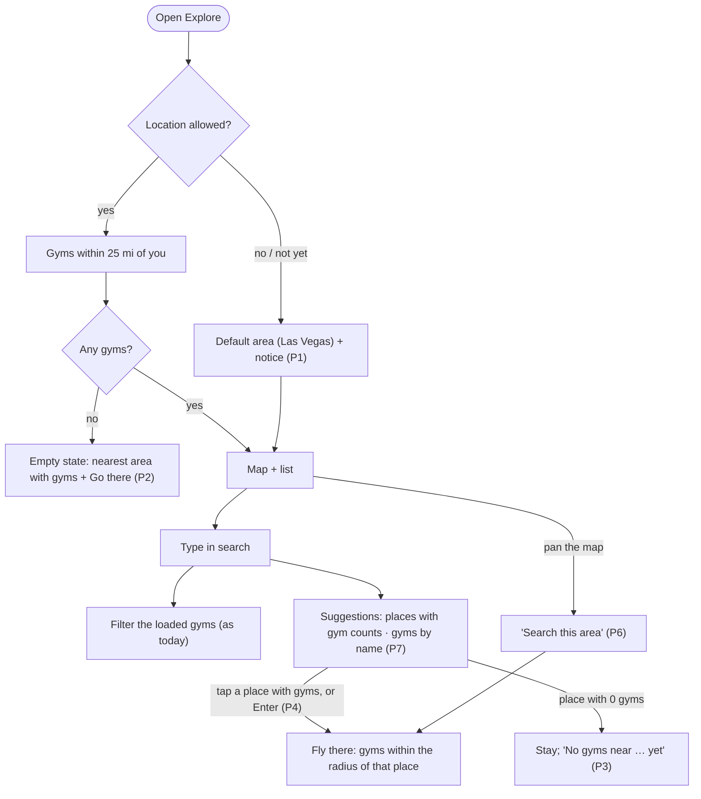
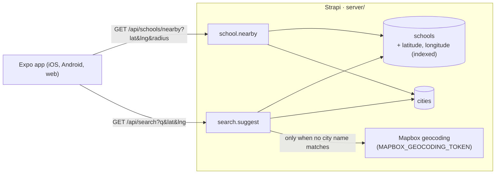

# 08 · Nearby gyms and place search: no city picker

**Status:** plan, for review (2026-10-19). Builds on M0–M13 (all merged). Milestones **M14–M16** below; their issue
drafts are in `issues/11-m14-…`, `12-m15-…` and `13-m16-…`.

Today Explore loads one city's gyms (`EXPO_PUBLIC_DEFAULT_CITY`, `las-vegas`) and the search box only filters that list.
So if MatFinder lists gyms in West Hartford, nobody can find them: typing "west hartford" gives "No gyms match" and the
map stays on Las Vegas. This plan makes Explore about **where you are, or where you searched, plus a radius**. Cities
stay in the data (timezone, center, name, and the MCP tools' `citySlug`) but are never something the user picks.

## What the user decided (2026-10-19)

| Question | Decision |
|---|---|
| A city picker? | **No.** Explore is based on your location and a radius. |
| Default radius | **25 miles.** |
| Searching a place that has gyms (e.g. "West Hartford") | **Switches you there:** the map flies over and the list shows that area's gyms. |
| This replaces M6's confirmed rule (2026-10-01) | "The map centers on the device only within 60 miles of the city (otherwise the city center)" goes away. Where you are comes first; the city no longer frames the map. |

## Proposed, for your review

These follow from the decisions above. Each is a recommendation; say if you want it different.

| # | Question | Recommendation |
|---|---|---|
| P1 | Location denied, or not answered yet | Open on the default area (the center of `EXPO_PUBLIC_DEFAULT_CITY`) with a notice: "Showing Las Vegas · Turn on location to see gyms near you". |
| P2 | Location granted, but no gyms within the radius | Stay on your location and show the empty state: "No gyms within 25 mi of you yet. Nearest: Las Vegas, NV · 2,280 mi", with a button that goes there. |
| P3 | A place with **no** gyms near it | Don't move the map. Its suggestion row reads "No gyms near West Hartford, CT yet" and can't be tapped. |
| P4 | Pressing Enter / the keyboard's search key | If no gym in the current area matches the text and the top place has gyms, switch there (the decision above). Otherwise just filter, as today. Typing alone never moves the map. |
| P5 | Radius choices | A chip: **10 · 25 · 50 mi**. |
| P6 | Panning the map somewhere else | A "Search this area" pill appears; tapping it loads the gyms around the map's center. |
| P7 | Gym names outside the area | Search suggestions also list gyms by name from anywhere ("Engle Jiu Jitsu · Henderson, NV"); tapping one switches to it and opens its preview. |
| P8 | Distances when you've switched to another place | Still measured from **you** (hidden without location permission), because that's the trip you'd make. |

## The experience



The URL carries where you're looking, so links and reloads keep the view: `/?at=41.76,-72.74&r=50&q=…`. Without
`at` the app uses your location (or the default area). `r` is left out when it's 25.

## Architecture



- **Radius queries need numbers the database can index.** Today a gym's coordinates live only inside the `location`
  map field (JSON), so nothing can filter by distance in SQL. M14 adds plain `latitude` / `longitude` columns that a
  Document Service middleware keeps in sync with `location`.
- **"Today" stays local to each gym.** A 25-mile circle rarely crosses a time zone, but a switch can land anywhere, so
  the response carries each city's local date and weekday and every gym says which city it's in.
- **`GET /api/schools/directory?city=` stays** as it is: the e2e suite, the MCP tools' city model and any old links use
  it. Explore stops calling it in M16.

## Data model

**School: two new fields** (in `api::school.school`):

| Field | Type | Notes |
|---|---|---|
| `latitude` | float | Copied from `location.latitude` on every create, update and publish (a Document Service middleware in `src/document-middlewares/`). Never set by hand; hidden from the Content Manager (`config.attributes.*.hidden` in the schema). |
| `longitude` | float | Same, from `location.longitude`. |

`float` rather than `decimal` (changed in M14): Strapi 5.58 maps `decimal` to a fixed `decimal(10, 2)`, which would round every position to about 1 km. `float` is a `double` column with full precision.

- A bootstrap step **backfills** existing schools once (where `latitude` is null and `location` has coordinates).
- An **index** on `(latitude, longitude)` is created next to the existing `UNIQUE_INDEXES` in `src/index.ts`
  (a plain index, not unique). SQLite locally, Postgres on Strapi Cloud.
- Cities are unchanged. **Adding a new market** stays a data task: create the City (name, slug, timezone, center) with
  the content-manager MCP tools or the admin, then run `find_new_gyms` for it.

## Endpoints

Both are public (added to `GRANTS.public` and `GRANTS.authenticated` in `src/lib/permissions.ts`) and go through the
Vercel `/api` rewrite like the rest.

### `GET /api/schools/nearby?lat=<n>&lng=<n>&radius=<miles>` (M14)

- `radius` defaults to **25**, clamped to 1–100. `lat` / `lng` are required and range-checked (`400` otherwise).
- Query: bounding box on the indexed columns (`$between`), then the exact haversine distance, sorted by distance, at
  most **300** gyms (the response says `truncated: true` past that).
- `Cache-Control: public, max-age=60`. The app rounds `lat` / `lng` to **2 decimals (about 1 km)** before calling, which
  helps caching and means a precise device position never reaches the server or its logs.

```jsonc
{ "data": {
  "center": { "latitude": 36.17, "longitude": -115.14 }, "radius": 25, "generatedAt": "…", "truncated": false,
  "cities": { "las-vegas": { "name": "Las Vegas", "state": "NV", "timezone": "America/Los_Angeles",
                             "localDate": "2026-10-19", "weekday": "mon" } },
  "schools": [ { /* today's directory item, unchanged */ "citySlug": "las-vegas", "distanceMiles": 4.2 } ],
  "nearest": null  // when schools is empty: { "citySlug", "name", "state", "center", "distanceMiles" } of the closest city with gyms (P2)
} }
```

### `GET /api/search?q=<text>&lat=<n>&lng=<n>` (M15)

- `q` needs at least 3 characters. `lat` / `lng` are optional; they rank places and gyms by closeness to you.
- **Places**, in this order, at most 5:
  1. **MatFinder cities** whose name matches (accent- and case-insensitive). No Mapbox call.
  2. Otherwise **Mapbox forward geocoding**: US, types `place, locality, neighborhood, postcode`, up to 5 results, biased
     to `lat` / `lng`. Server-only `MAPBOX_GEOCODING_TOKEN`; the token never appears in responses or logs.
  - Each place gets `gymCount`: published gyms within **25 mi** of it (the same query as `/nearby`). Places with gyms
    sort first.
- **Gyms** by name, neighborhood, ZIP or team, from **anywhere**, at most 5, with their city (P7).
- `Cache-Control: public, max-age=300`.

```jsonc
{ "data": {
  "places": [ { "name": "West Hartford, CT", "latitude": 41.76, "longitude": -72.74, "gymCount": 6, "source": "city" } ],
  "gyms":   [ { "slug": "…", "name": "…", "citySlug": "…", "cityName": "…", "state": "CT", "latitude": 0, "longitude": 0 } ]
} }
```

## App

- **Explore's data** comes from a new `useNearby(center, radius)` (TanStack Query, `staleTime` 60 s, refetch on focus
  and on local-date change, as `useDirectory` does today). `center` = the `at` param, else the device location, else
  the default area (P1).
- **Header:** "MatFinder · Near you", or the place you switched to ("MatFinder · West Hartford, CT"), or the default area.
- **Search box** (`SheetSearch`): typing still filters the loaded gyms at once. From 3 characters, a suggestion list
  (debounced 300 ms) shows **Places** ("West Hartford, CT · 6 gyms") and **Gyms** from elsewhere. Tapping a place sets
  `at` and clears `q`; tapping a gym sets `at` to it and selects it (`school=`). Enter follows P4.
- **Radius chip** in `FilterBar` (P5). **"Search this area"** pill (P6) after the map's center moves more than a third
  of the radius from `at`. The **recenter** button goes back to your location and drops `at`.
- **Time:** each gym's "Training today", "On now" and next session use its own city's `localDate` / `weekday` /
  timezone from the response. `useCityNow` runs per city in the response (usually one).
- **Removed:** `NEAR_CITY_MILES` and the city-centered camera rules in `app/index.tsx`. The camera fits the loaded gyms
  (as it does now with filters), or centers on `at` at the radius's zoom when there are none.
- Built in the Mat room look from the theme tokens. No new screens; the sheet, filters and cards stay.

## Privacy

- The device position is rounded to about 1 km before any request (P8 distances are still computed on the device
  from the exact position, as today).
- Search text goes to our server, and from there to Mapbox only when it doesn't match a MatFinder city. Nothing is
  stored.

## Milestones

Each is one branch and PR, in order, merged by you.

### M14 · Coordinates and the nearby API
- [ ] School `latitude` / `longitude`, the sync middleware, the backfill and the index.
- [ ] `GET /api/schools/nearby` (service + controller + route + grants), including `nearest` for an empty result.
- [ ] Unit tests for the radius math (bounding box, haversine, clamping); integration tests for the endpoint.
- **Done when:**
  - Integration: the 8 sample gyms come back around the Las Vegas center at 25 mi, sorted by distance; none at 10 mi
    from a point 40 mi out; `nearest` names Las Vegas from a point in Connecticut; bad `lat` / `radius` → 400.
  - Editing a gym's location in the admin updates `latitude` / `longitude` (and a draft write through MCP does too).
  - `npm run test:unit` and `npm run test:integration:isolated` pass; `/directory?city=` answers exactly as before.

### M15 · Search suggestions
- [ ] `GET /api/search` (places from cities first, then Mapbox; gyms from anywhere) + grants.
- [ ] `lib/geocode.ts` gains a place search (types and limit above) next to the existing address geocoder.
- [ ] Unit tests with a mocked Mapbox; integration tests against the seed.
- **Done when:**
  - "las vegas" returns the Las Vegas city place with `gymCount: 8` and makes **no** Mapbox call.
  - A place name with no gyms nearby comes back with `gymCount: 0`; with no `MAPBOX_GEOCODING_TOKEN` the endpoint
    still answers (city places and gyms only) instead of failing.
  - "garage" (a sample gym) returns that gym with its city.

### M16 · Explore by location and radius
- [ ] `useNearby`, the `at` / `r` params, the header, P1 and P2.
- [ ] Search suggestions in `SheetSearch` (places and gyms), switching on tap and Enter (P3, P4, P7).
- [ ] Radius chip, "Search this area", recenter; per-city time.
- [ ] Remove the city-centered camera rules and `NEAR_CITY_MILES`.
- [ ] Unit tests (URL params, rounding, which suggestion Enter picks); Playwright with geolocation set.
- **Done when:**
  - Playwright, geolocation in Las Vegas: the 8 sample gyms show; "Training today" still matches Las Vegas time.
  - Playwright, a second test city with one gym seeded far away: searching its name shows "<City> · 1 gym", Enter
    switches there, the URL has `at=`, and a reload stays there.
  - Playwright, geolocation with no gyms in range: the empty state names the nearest area and its button goes there.
  - The same flows work in the iOS Simulator (location set with Features → Location).
  - Web, iOS: typing never moves the map; only a tap, Enter or the pill does.

## Risks and checks

- **Mapbox tokens (now, not just for M15).** Production Strapi and Vercel use the **same** `pk.` token, and Strapi
  Cloud has no `MAPBOX_GEOCODING_TOKEN`. Restricting that token to the Vercel domain would break the Strapi admin's map
  field and all server geocoding, because server requests send no referrer. Before restricting it: create a second,
  unrestricted token for the server, set it as `MAPBOX_GEOCODING_TOKEN` on Strapi Cloud, and allow both the Vercel and
  the `*.strapiapp.com` admin URLs on the `pk.` token.
- **Mapbox terms and API version (verify in M15).** `lib/geocode.ts` calls the v5 `mapbox.places` endpoint. Check
  whether v6 is now the one to use, and whether "temporary" geocoding results may be cached. Plan: no server-side
  cache unless the terms allow it; the 3-character minimum, the 300 ms debounce and city-name matches keep calls down.
- **Column type (settled in M14).** Strapi 5.58's `decimal` is a fixed `decimal(10, 2)`, too coarse for coordinates, so the columns are `float` (`double`).
- **Sample data for the tests.** The seed has one city. M16's Playwright needs a second, far-away test city with one
  gym; add it to the test seed only (`SEED_SAMPLE_DATA`), never to production.
- **AC1 changes.** "Signed out, the web app opens on a map centered on the device location (or the Las Vegas center if
  denied)" becomes P1/P2. Update `06-build-spec.md`'s AC1 note when M16 merges.
